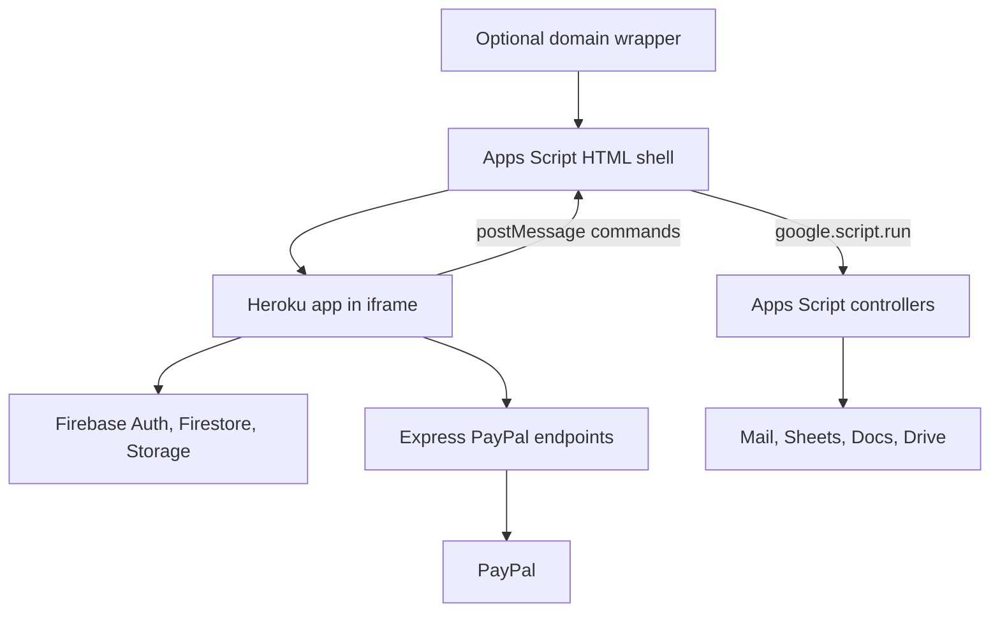

# GHOST legacy architecture baseline

Recorded 2026-10-30. First-pass static review; production behavior remains unverified.

Canonical discussion: [GitHub issue #1](https://github.com/williamowen65/ghost-rewrite/issues/1). Related: [SRS](SRS.md) and [roadmap](MILESTONES.md).

## Purpose

Establish a first-pass architecture baseline for the GHOST rewrite, explain how the imported projects relate, and identify decisions to turn into implementation issues. This issue is for discussion and planning; it does not select a replacement stack or authorize a production migration.

Reviewed repository snapshot: `2918b8a16c09d0c51735f43c542e790d64d94c5c`. Static source review only: no production requests, emails, payments, deployments, or database changes were made. Live deployment configuration and data have not been verified.

## 1. What the three folders represent

| Folder | Observed role |
| --- | --- |
| `ghost-committee-web-app_members-site` | Browser UI **plus an Express server**, Firebase access, PayPal endpoints, and browser-side business workflows. The owner confirms Heroku hosting. |
| `ghost-server-configruation` | Older Apps Script configuration wrapper. Its README describes wrapping a Google-Server submodule; the remaining .gitmodules points to that external repository. Its deployment source still references Glitch. |
| `latest-ghost-clasp-deployment` | The most complete checked-in Apps Script deployment source: Google-Server router/controllers, Apps Script manifest, and deployment source pointing to the Heroku app. Treat this as the leading candidate for the Google integration baseline, pending comparison with the live script. |

Evidence: [ghost-committee-web-app_members-site/server.js](https://github.com/williamowen65/ghost-rewrite/blob/2918b8a16c09d0c51735f43c542e790d64d94c5c/legacy-code/ghost-committee-web-app_members-site/server.js), [ghost-server-configruation/README.md](https://github.com/williamowen65/ghost-rewrite/blob/2918b8a16c09d0c51735f43c542e790d64d94c5c/legacy-code/ghost-server-configruation/README.md), [ghost-server-configruation/.gitmodules](https://github.com/williamowen65/ghost-rewrite/blob/2918b8a16c09d0c51735f43c542e790d64d94c5c/legacy-code/ghost-server-configruation/.gitmodules), [ghost-server-configruation/deployment-management.js](https://github.com/williamowen65/ghost-rewrite/blob/2918b8a16c09d0c51735f43c542e790d64d94c5c/legacy-code/ghost-server-configruation/deployment-management.js), [latest-ghost-clasp-deployment/deployment-management.js](https://github.com/williamowen65/ghost-rewrite/blob/2918b8a16c09d0c51735f43c542e790d64d94c5c/legacy-code/latest-ghost-clasp-deployment/deployment-management.js).

The configuration wrapper and latest deployment appear to be overlapping historical/deployment artifacts, rather than two independent Google business services. Verify that interpretation against the deployed Apps Script before consolidating.

## 2. Current runtime relationships

- Express serves pages and assets and proxies PayPal order/capture requests. It is not currently the central application/business API.
- Browser modules use Firebase Authentication, read/write Firestore, upload images to Firebase Storage, and listen for changes through global `firebase` and `CRUD` objects.
- Apps Script `doGet` creates a full-screen iframe containing the Heroku app. The browser sends commands to its Apps Script parent using `postMessage`.
- The Apps Script page checks the sender origin against `getDeploymentSource()`, then forwards Gmail/Sheets/Drive/Docs commands using `google.script.run`.
- Responses are posted back to the app and distinguished by controller name.
- A separate `domain-management/index.html` adds an outer iframe and navigation synchronization. Its exact role in the current public deployment needs confirmation.

Evidence: [ghost-committee-web-app_members-site/dist/firebase.js](https://github.com/williamowen65/ghost-rewrite/blob/2918b8a16c09d0c51735f43c542e790d64d94c5c/legacy-code/ghost-committee-web-app_members-site/dist/firebase.js), [ghost-committee-web-app_members-site/dist/CRUD.js](https://github.com/williamowen65/ghost-rewrite/blob/2918b8a16c09d0c51735f43c542e790d64d94c5c/legacy-code/ghost-committee-web-app_members-site/dist/CRUD.js), [ghost-committee-web-app_members-site/app/pages/members/index.html](https://github.com/williamowen65/ghost-rewrite/blob/2918b8a16c09d0c51735f43c542e790d64d94c5c/legacy-code/ghost-committee-web-app_members-site/app/pages/members/index.html), [latest-ghost-clasp-deployment/Google-Server/router.js](https://github.com/williamowen65/ghost-rewrite/blob/2918b8a16c09d0c51735f43c542e790d64d94c5c/legacy-code/latest-ghost-clasp-deployment/Google-Server/router.js), [latest-ghost-clasp-deployment/Google-Server/domain-management/index.html](https://github.com/williamowen65/ghost-rewrite/blob/2918b8a16c09d0c51735f43c542e790d64d94c5c/legacy-code/latest-ghost-clasp-deployment/Google-Server/domain-management/index.html).

## 3. Business behavior visible in the source

- Membership contracts: artist details, images, studio sharing, committee assignments, configurable contract content, payment status and receipts.
- New artist and scholarship applications, review interfaces, and notification email modules.
- Member dashboard, timeline, active year, roles and privileges.
- Contract export to Google Sheets.
- Intended contract PDF/document/folder workflow, with incomplete or mismatched checked-in pieces.

**Payment example:** browser creates an order through Express → browser requests capture through Express → browser writes membership-paid status/receipt to Firestore → browser sends member/board email commands and updates committee assignments. A successful payment followed by a closed tab or failed write/email can therefore leave partial application state. The backend should own payment verification and durable completion in the rewrite.

**Sheets example:** browser reads contracts and roles from Firestore, builds export columns, and supplies the spreadsheet ID and records to `sheetsController`. Although a CRUD comment describes updating both stores, the reviewed CRUD methods themselves write Firestore; the explicit Sheets export is separate. I did not establish a reverse Sheets-to-Firestore synchronization path.

**PDF example:** `processContractsToPdf` requests `addContent`, `addDocToFolder`, `convertToPdf`, and `addPdfToFolder`; those names are absent from the checked-in controller implementations. Docs supports `convertDocToPDF` instead, and returns IDs in a different shape from some caller expectations. The standalone PDF/Drive export files are empty. This establishes source contract mismatches, not a claim that every live production export is broken.

Evidence: [ghost-committee-web-app_members-site/app/components/3rdParty/paypal/index.js](https://github.com/williamowen65/ghost-rewrite/blob/2918b8a16c09d0c51735f43c542e790d64d94c5c/legacy-code/ghost-committee-web-app_members-site/app/components/3rdParty/paypal/index.js), [ghost-committee-web-app_members-site/app/api/paypal/order.js](https://github.com/williamowen65/ghost-rewrite/blob/2918b8a16c09d0c51735f43c542e790d64d94c5c/legacy-code/ghost-committee-web-app_members-site/app/api/paypal/order.js), [ghost-committee-web-app_members-site/app/api/paypal/capture.js](https://github.com/williamowen65/ghost-rewrite/blob/2918b8a16c09d0c51735f43c542e790d64d94c5c/legacy-code/ghost-committee-web-app_members-site/app/api/paypal/capture.js), [ghost-committee-web-app_members-site/app/exports/google-sheets/processContractsToSheets.js](https://github.com/williamowen65/ghost-rewrite/blob/2918b8a16c09d0c51735f43c542e790d64d94c5c/legacy-code/ghost-committee-web-app_members-site/app/exports/google-sheets/processContractsToSheets.js), [ghost-committee-web-app_members-site/app/pages/members/index.js](https://github.com/williamowen65/ghost-rewrite/blob/2918b8a16c09d0c51735f43c542e790d64d94c5c/legacy-code/ghost-committee-web-app_members-site/app/pages/members/index.js), [latest-ghost-clasp-deployment/Google-Server/controllers/DocumentApp.js](https://github.com/williamowen65/ghost-rewrite/blob/2918b8a16c09d0c51735f43c542e790d64d94c5c/legacy-code/latest-ghost-clasp-deployment/Google-Server/controllers/DocumentApp.js), [latest-ghost-clasp-deployment/Google-Server/controllers/DriveApp.js](https://github.com/williamowen65/ghost-rewrite/blob/2918b8a16c09d0c51735f43c542e790d64d94c5c/legacy-code/latest-ghost-clasp-deployment/Google-Server/controllers/DriveApp.js).

## 4. Main architectural pressure points

1. **Business rules are distributed through UI code.** Payment completion, email recipients/templates, permissions, committee assignment and exports depend on browser execution.
2. **Google integration exposes generic capabilities.** The browser selects actions, recipients, document/folder IDs, spreadsheet IDs and content. Prefer named business operations with resource selection and authorization enforced by trusted code.
3. **Caller identity does not carry through the bridge in the reviewed code.** The manifest specifies `USER_DEPLOYING` and `ANYONE_ANONYMOUS`; the controllers do not visibly verify Firebase identity or role. An origin check is useful transport validation, but does not identify or authorize an individual member.
4. **Firebase rules need deliberate redesign.** The checked-in Firestore rules permit reads/writes broadly to authenticated users and allow public writes to new applications. UI privilege checks do not substitute for data/API authorization. Confirm deployed rules separately.
5. **Messaging lacks request correlation and a unified error contract.** Controller-name responses, nested persistent listeners, wildcard response targets and error objects returned as successful RPC results make concurrency and recovery difficult.
6. **Exports need batch processing and recoverability.** Sheets `upsertAll` recursively processes each row; each upsert scans the sheet again for image formatting. Separate mapping from batched writes and track completion/failures.
7. **Deployment/source boundaries are unclear.** Glitch references remain alongside Heroku; the old Google Cloud Function experiment is marked unused by the README; handwritten Firebase/CRUD modules live under `dist` beside generated bundles. The main package has a placeholder failing test script.

These are first-pass design observations, not a completed security audit or runtime assessment.

## 5. Proposed organization

Keep the legacy snapshot as a reference while building a separately runnable replacement. Suggested logical boundaries (folder names are illustrative; language/framework remains undecided):

- **Web:** forms, navigation, display and authenticated requests.
- **Application:** submit/review applications, save contracts, assign roles, calculate fees, complete payments, request exports.
- **Data:** repositories and image storage; explicitly decide the authoritative data store.
- **Integrations:** PayPal and Google adapters behind application-owned interfaces.
- **Jobs:** durable email/export work, retry handling, deduplication and status.
- **Optional Apps Script project:** one canonical source/deployment configuration, if retained.

Use business-oriented interfaces such as `ExportContractsForYear` and `SendMembershipReceipt`. Keep Docs/Drive/Sheets mechanics private to adapters. A router/controller split is not inherently the problem; the more significant issue is generic privileged operations coupled to browser-side orchestration.

Do not assume that replacing Firebase, Heroku, the frontend framework, and Apps Script must happen together.

## 6. Google integration options

### A — Keep Apps Script, narrow its responsibility

A reasonable lower-migration option if running under the organization's Google account and minimizing integration setup are priorities.

- Consolidate Google source into one project; verify live code before retiring the older wrapper.
- Evaluate a standalone Apps Script project; spreadsheet binding need not be an application architecture boundary. Target spreadsheet/folder configuration should be explicit.
- Replace generic browser commands with a small set of authorized business operations.
- Separate transport, validation, workflows and Google-specific adapters.
- If the iframe bridge remains temporarily, add request IDs, timeouts, strict sender/source validation and consistent error handling.
- Design and validate backend-to-Apps-Script authentication/deployment access before treating it as a replacement transport. Changing to a public `doPost` endpoint alone would not solve authorization.

Costs: an additional runtime/deployment, Apps Script execution/quota constraints, and cross-runtime authentication/retry complexity.

### B — Application backend calls Google APIs directly

**Preferred direction to investigate for a substantial rewrite:** browser → authenticated application backend → Google integrations. Host the member UI directly, removing the Apps Script iframe bridge when migration is complete.

- Keep membership/review/payment authorization and Google operation authorization in the application backend.
- Use explicit OAuth consent/token ownership for the organization's account as appropriate.
- Evaluate service accounts for resources explicitly shared with them. Do not assume a service account automatically has Gmail mailbox access; Workspace impersonation/domain-wide delegation depends on administrator support and authorization.
- Compare Gmail versus a transactional mail provider separately from Sheets/Drive decisions.
- Keep Sheets as an operational export unless bidirectional editing is an explicit requirement.

Costs: OAuth/token lifecycle management, Google Cloud configuration and operational ownership. This option simplifies the browser architecture but does not eliminate Google identity/setup work.

**Provisional recommendation:** favor B as the long-term target, while retaining A as a viable incremental path. First establish the Google account type, mailbox identity, administrators available, and operational workflows. No migration decision is final in this issue.

Google documentation to consult during the implementation spike:
- https://developers.google.com/apps-script/guides/web
- https://developers.google.com/apps-script/guides/standalone
- https://developers.google.com/identity/protocols/oauth2/service-account

## 7. Questions to resolve with the owner

- Which checked-in Apps Script version matches production, and are there unpushed editor changes?
- Is the deploying identity a consumer Google account or Google Workspace account? Who owns it and can administer it?
- Must outgoing mail come from the existing GHOST mailbox?
- Is Sheets export-only, or do staff need spreadsheet edits to update application data?
- Which PDF, image-to-Drive and export workflows are actually used today?
- Which outer website/domain wrappers are still active?
- What annual rollover, fee/discount, scholarship and role-assignment behavior must be preserved?
- What are the larger requested changes before selecting the rewrite stack?

## 8. Follow-up backlog candidates — not yet created

- [ ] Reconcile production Apps Script source/deployment configuration and establish one canonical Google project.
- [ ] Inventory workflows and data ownership; document required behavior and the owner's requested changes.
- [ ] Decide Google integration/authentication approach with a small non-production spike.
- [ ] Define server-enforced ownership/role rules and public application submission boundaries.
- [ ] Move payment completion and membership-state changes behind verified backend workflows.
- [ ] Design durable notifications and export jobs with retry/deduplication behavior.
- [ ] Define export schemas and complete/test the required document/PDF workflow.
- [ ] Establish the new project structure, environment configuration and deployment pipeline.
- [ ] Add behavior tests for the agreed critical workflows and a staged data migration/cutover plan.

## Completion criteria for this planning issue

- [ ] Owner reviews/corrects this baseline.
- [ ] Production/source discrepancies and active Google workflows are identified.
- [ ] Google account/authentication constraints are recorded.
- [ ] A migration direction is selected with rationale.
- [ ] Agreed work is split into focused GitHub issues.

No application code changes are included.
